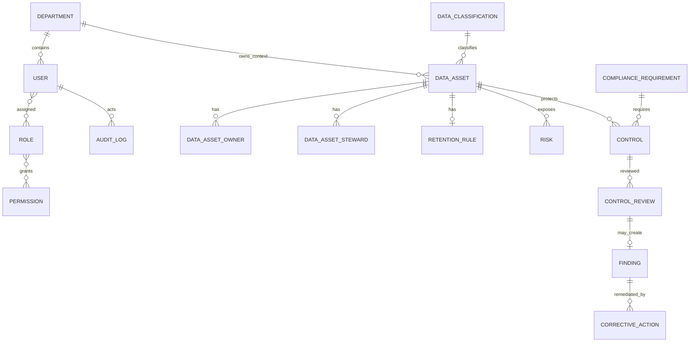

# Presentation Handoff Document

## Read this first — 5 things you must understand before presenting

1. This is a **governance and privacy-compliance support layer**, not Newgate University's Student Information Management System (SIMS). It records how student data should be governed; it does not hold or replace the operational student portal.
2. The working MVP centres on classified data assets, role-based access, access requests, risks, controls/reviews/findings, corrective actions, and audit records.
3. It supports selected privacy and governance controls. It **does not certify a university as NDPA- or ISO-compliant** and it does not replace a Data Protection Officer (DPO).
4. The database contains synthetic demonstration data only. The main end-to-end example is **Examination Results** (`AST-0001`).
5. Be precise about maturity: incidents, data-subject requests, retention/disposal, quality, access reviews, third parties and training can be registered, but several are basic records rather than complete workflow engines.

## 1. Project title

**Formal title:** *Data Governance and Privacy Compliance Management System for Student Information Management Systems: A Case Study of Newgate University, Minna.*

**Plain-English title:** *Student Data Governance & Privacy Compliance Platform.*

## 2. Project in one minute

A university handles sensitive student information such as examination results, identity details and academic records. The difficulty is often not that data exists, but proving who is responsible for it, who should access it, why it is processed, how long it is retained, and what happened when a control failed.

This web application gives authorised university staff a shared governance register. It records data assets and their owners/stewards, applies role-based permissions, routes access requests through independent approval and ICT application, records risks and compliance-control reviews, and follows findings through corrective action and independent verification. It protects accountability around student information, rather than acting as the system where students register courses or view grades.

**Memorise this (about 45 seconds):** “My project is a data-governance and privacy-compliance management platform for a university student-information environment. It does not replace the university SIMS. Instead, it helps the institution document and monitor responsibility, access, risks, controls and remediation around student data. For example, it can show that Examination Results are confidential, who owns and stewards them, the legal/administrative purpose, an access-control risk, the control review that found a weakness, and the corrective action used to address it. It gives evidence for better governance, but it does not by itself guarantee legal compliance.”

## 3. The core problem

Privacy policies can exist on paper while daily practice remains unclear. A university may not know every student-data asset, its accountable owner, or whether access remains necessary. Excess privilege, poor logs, disconnected risk registers, untracked incidents, indefinite retention and no follow-up on findings make it hard to demonstrate responsible operation. Third-party providers and staff training can also be invisible.

That creates a gap between a **legal or policy obligation** and **operational proof**. This prototype narrows that gap by giving staff a place to document selected controls, decisions and evidence references. It does not remove the need for policies, trained people, technical safeguards or legal judgement.

## 4. Legal and regulatory basis

| Reference | Contribution to the project | Reflection in this MVP |
| --- | --- | --- |
| Nigeria Data Protection Act 2023 (NDPA) | Encourages lawful, accountable handling of personal data and respect for data-subject rights. | Processing purpose/lawful-basis fields, classifications, access governance, controls, incidents and data-subject-request register. |
| Nigeria Data Protection Commission guidance / GAID | Provides the Nigerian privacy-governance context in which organisations document and demonstrate accountable practice. | Compliance requirements can identify a framework and reference; seed data includes an NDPA 2023 access-control requirement. |
| ISO/IEC 27001 | Information-security management concepts: access control, risk treatment, monitoring and evidence. | RBAC, risk register, controls/reviews, corrective actions and audit events. |
| ISO/IEC 27701 | Privacy-information-management concepts: privacy roles, processing and privacy controls. | Data owners/stewards, purpose/lawful basis, requests, retention and incident registers. |
| NIST privacy/security principles | Practical ideas such as least privilege, accountability, risk management and monitoring. | Permission checks, self-approval prevention, risk scoring, audit logs and review records. |

These are **design references**, not a statement of ISO certification or complete NDPA/NDPC compliance. Formal compliance requires organisational policies, legal assessment, evidence, technical controls and continued operation beyond this software.

## 5. System users and permission matrix

The six seeded roles are below. Permissions are enforced in server-side page/action guards; navigation also hides unavailable main-menu items.

| Role | Represents / can do | Cannot do (unless also given another role) | Why it matters |
| --- | --- | --- | --- |
| Super Administrator | Full set of permissions: users, roles, assets, requests, risks, reviews, operations, logs and reports. | No special bypass is implemented for corrective-action self-verification. | Central administration, while workflow checks still apply. |
| Privacy Officer | Manage assets and risks; review controls; manage corrective actions, incidents and data-subject requests; view logs/reports. | Cannot manage users/roles/departments or approve/apply access requests. | Separates privacy oversight from identity administration and technical provisioning. |
| Data Owner | View dashboard/assets/risks/compliance; approve access requests. | Cannot create assets, manage risks, apply access or administer users. | Accountable business owner can decide access without provisioning it. |
| Data Steward | View/create/update assets, create access requests and view risks. | Cannot approve/apply access, review controls, manage users or view logs. | Supports data documentation without granting governance-wide authority. |
| ICT Officer | Create/apply access requests; view assets/risks; manage incidents and corrective actions. | Cannot approve requests, review controls, administer users or view logs/reports. | Technical staff apply approved access, rather than approving their own work. |
| Management Viewer | View dashboard, assets, risks, compliance and reports. | Cannot create, review, approve, apply or administer records. | Provides oversight with read-only business access. |

Exact permission keys are displayed at `/roles`: `dashboard.view`, user/role management, asset view/create/update, request view/create/approve/apply, risk view/manage, compliance view/review, corrective-action/incidents/data-subject-request management, audit-log view and report view.

## 6. System architecture

The application uses **Next.js 16 App Router**, React 19, TypeScript and Tailwind CSS. Server Actions implement writes; Prisma 6 is the ORM for a PostgreSQL database. Zod validates the principal structured forms. Authentication checks bcrypt password hashes and creates an 8-hour HS256 JWT session stored in an HTTP-only, SameSite=Lax cookie (Secure in production). `jose` verifies that session. There is no separate backend service or external identity provider.

Reporting is two protected route handlers that return CSV: open risks and overdue corrective actions. No file/evidence storage service, email service, SIMS integration or public API is implemented. The Docker production composition assumes PostgreSQL 16 and a Node 22 app container, with environment-supplied database/session secrets.

```text
Authorised staff member
        ↓ browser
Next.js web application (pages, forms, Server Actions)
        ↓
Login: bcrypt verification → signed HTTP-only session cookie
        ↓
Permission guard (user → role(s) → permission)
        ↓
Prisma application data access / audit writes
        ↓
PostgreSQL: governance, compliance and audit records
        ↓
Protected CSV report routes / dashboard calculations
```

Security approach actually present: password hashing, active-account checks, server-side permission checks, Zod on several core forms, database unique/foreign-key constraints, transaction-wrapped core changes and audit events. It does not demonstrate rate limiting, MFA, SSO, encryption/key management, malware scanning, field masking or a hardened production database role.

## 7. Database / data model

**People and access.** `User` belongs optionally to a `Department`, has one or more `Role`s through `UserRole`, and roles receive `Permission`s through `RolePermission`. `AuditLog` identifies an actor when available. `AccessRequest` identifies requester, optional approver and optional ICT applier.

**Governance inventory.** `DataAsset` is the centre: it has a department, `DataClassification`, many owners and stewards, one optional `RetentionRule`, and related risks, controls, incidents, quality issues, third-party links and disposal records. Classifications are Public, Internal, Confidential and Restricted in seed data.

**Compliance and remediation.** `ComplianceRequirement` has controls. Each `Control` relates to one data asset and has many `ControlReview`s. A review can have one `Finding`; a finding can have corrective actions. A corrective action has an assignee and optional independent verifier.

**Extended registers.** Incidents, data-subject requests, disposal records, quality issues, access reviews, third parties and training events are persisted as separate entities.



## 8. Core system workflow

1. **Register data asset:** record name, classification, department, processing purpose, optional lawful basis, owner, steward and retention rule. Creation makes it Active and logs the action.
2. **Associate governance records:** risks and compliance controls reference the asset. The seeded asset has a requirement and control.
3. **Review a control:** a Privacy Officer/Super Admin records a result, notes and an evidence reference. Partially compliant or non-compliant results automatically create a finding.
4. **Create corrective action:** an authorised operations user selects an unassigned finding, assigns an officer, priority and due date.
5. **Remediate and verify:** only the assignee can submit completion notes/evidence. A different authorised user may close it or reopen it. This is the clearest segregation-of-duties workflow.
6. **Monitor:** dashboard counts and CSV reports use stored records; audit logs show recorded application activity.

Risk registration is related but separate: an authorised user records likelihood and impact against an asset, receiving a calculated score/level. Incident and data-subject-request records are currently registration-only, not linked automatically into corrective actions.

## 9. Feature-by-feature guide

| Page / route | Purpose, audience and key actions | Compliance connection / current boundary |
| --- | --- | --- |
| `/dashboard` | Any dashboard viewer sees Overall Compliance, Open Risks, Overdue Actions, Governed Assets and six latest audit records. | Read-only overview; cards are not links/charts. |
| `/users`, `/departments` | User/department administration for `users.view`/`users.manage`; create user, assign one role, suspend/activate others. | Identity accountability. Create/status actions require `users.manage`. |
| `/roles` | Shows role permission keys and user count. | View-only; role/permission editing is not implemented despite `roles.manage` existing. |
| `/data-assets`, `/data-assets/[id]` | List/detail assets; authorised users can register a classified asset with owner, steward and retention period/trigger. | Main governance inventory. Detail page shows only core asset fields, not linked risks/controls. |
| `/access-requests` | Requester submits resource, permission, reason and optional expiry. Owner approves/rejects; ICT applies. | Independent approval; resource is free text, not a foreign key to DataAsset. |
| `/risks` | View register; risk managers create a risk with likelihood, impact, treatment plan and asset. | Score/level calculation. No status-edit UI or owner field. |
| `/compliance` | Shows controls, requirement/asset/status/frequency; reviewers record result, notes and evidence reference. | Failed/partial review creates a finding. No controls/requirements creation UI. |
| `/corrective-actions` | Create from unassigned finding, assign, submit evidence, independently verify/close or reopen. | Most complete remediation workflow. |
| `/incidents` | Record a title, type, description, severity and optional asset; list number/title/status. | Initial registration only; no assignment/status/containment update UI. |
| `/data-subject-requests` | Record free-text type and synthetic student reference; list status. | Initial registration only; no identity, due-date or completion UI. |
| `/retention`, `/data-quality`, `/access-reviews`, `/third-parties`, `/training` | Create basic disposal, quality, review, processor and training records. | Routes exist but are not in the main sidebar; no complete review/approval/status workflows. |
| `/audit-logs` | Last 100 audit records: time, actor, event, record and result. | Read-only application interface. |
| `/reports` | Download open-risks and overdue-actions CSV reports. | Management monitoring only. |

## 10. Dashboard explanation

| Metric | Real calculation / source | Why it matters |
| --- | --- | --- |
| Overall Compliance | For controls not `NOT_APPLICABLE`: Compliant = 1, Partially Compliant = 0.5, all other applicable statuses = 0; total ÷ applicable controls, rounded to a whole percentage. If none are applicable, 0%. | A simple indicator of recorded control-review status, not legal-compliance proof. |
| Open Risks | Count of risks whose status is neither `CLOSED` nor `ACCEPTED`. | Directs attention to unresolved/treatment risks. |
| Overdue Actions | Corrective actions due before the current time and not `COMPLETED`/`CLOSED`. | Identifies missed remediation deadlines. |
| Governed Assets | Active assets with at least one owner **and** steward ÷ active assets, rounded. | Shows ownership/stewardship coverage. |
| Recent activity | Six latest `AuditLog` records. | Gives a quick evidence trail. |

The cards are display-only: clicking them does nothing. There are no charts.

## 11. Role-based access control (RBAC)

```text
User → one or more Role records → role Permission records → protected page/action/API
```

**Authentication** proves the user has valid credentials and an Active account. **Authorisation** checks whether the signed session contains the required permission. Hiding a menu item is only convenience; server actions and protected pages call `requirePermission` too.

Least privilege means each role has only the permissions needed: ICT can apply an already approved access request but cannot approve it. Segregation of duties is also explicit in two places: a requester cannot approve/reject their own request, and a corrective-action assignee cannot verify their own completion. A logged-in Data Steward is therefore redirected from `/users`, while a logged-in requester cannot call the approve action successfully.

## 12. Access-request demonstration

Use the Data Steward account to submit access to “Examination Results,” permission “Read-only results access,” with a business reason of at least ten characters and optional expiry date. The request begins `SUBMITTED` and creates an audit record.

Sign in as Data Owner to approve it. The system blocks approval if requester and approver are the same user, logging a denied self-approval attempt. Then sign in as ICT Officer and click **Apply**; status becomes `APPLIED`, stores who applied it/time, and logs the action. A rejection is also supported from Submitted/Under Review. Expiry is stored but there is no automatic expiry, access provisioning connector or review scheduler.

## 13. Data-asset demonstration: Examination Results

Use seeded **AST-0001 — Examination Results**. It is Confidential academic-record data in the Examinations department, owned by Musa Abdullahi (Registrar) and stewarded by Fatima Ibrahim. Its processing purpose is academic assessment, progression and award decisions; its recorded lawful basis is “Institutional academic administration.” The retention rule is seven years from graduation or last academic activity, using the university records-retention policy and approved secure disposal.

The asset has seeded control **CTL-0001**, “Examination results access review,” under **REQ-0001** (NDPA 2023 / Access control), a Critical risk of excessive access, and a linked finding/action. The detail page itself shows classification, department, owner/steward, purpose, lawful basis and retention; linked records are demonstrated through their separate pages.

## 14. Risk management

An authorised risk manager enters a title, description, category, affected asset, likelihood 1–5, impact 1–5 and optional treatment plan. The server calculates:

`score = likelihood × impact`

| Score | Level |
| --- | --- |
| 1–4 | Low |
| 5–9 | Medium |
| 10–16 | High |
| 17–25 | Critical |

Seeded `RISK-0001` is likelihood 4 × impact 5 = 20, **Critical**, for excessive access to Examination Results. The schema supports statuses/review dates, but the MVP form does not capture a risk owner, review date or status updates; describe these as future work, not active workflow.

## 15. Compliance management

A requirement contains framework, reference, title and description. A control protects one data asset and records its frequency/status. On `/compliance`, a reviewer can record **Compliant, Partially Compliant, Non-Compliant or Not Applicable**, plus notes and an evidence reference. The server updates control status and last-review date. A partial/non-compliant result creates a finding with Low/Medium/High/Critical severity; the presenter can then create a corrective action from that finding.

The `ControlReview` table also has a next-review-date field, but the supplied form does not set it. There is no UI to create requirements/controls or directly display a review history/finding list.

## 16. Corrective-action workflow

Actual operational path:

`Finding → OPEN action → assignee submits completion → AWAITING_VERIFICATION → CLOSED or REOPENED`

The action includes title, required remediation, priority, assignee and due date. The assignee supplies completion notes and an evidence reference. A different authorised user verifies and closes it, or reopens it. The enum also includes `IN_PROGRESS` and `COMPLETED`, but this UI does not transition into those states; do not claim it does.

## 17. Incident management

The MVP lets an authorised user register an incident with a number, title, incident type, description, severity, detection date (set at creation) and optional affected asset. Example: report “Unauthorised examination-result export attempt,” type “Unauthorised access,” High severity, linked to Examination Results. It is created in `REPORTED` status and audited.

The database defines later statuses (Triaged, Investigating, Contained, Remediation in Progress, Resolved, Closed) and fields for containment/response notes, but the application currently offers **no update, assignment, investigation, corrective-action link or closure interface**. Present the intended lifecycle—Detection → Registration → Triage/Investigation → Response → corrective action → Closure—as the operational model, while clearly saying this MVP implements only registration/listing.

## 18. Data-subject requests

A data subject is the person to whom personal data relates. Students are data subjects because academic, identity and contact records relate to them. The current form accepts a **free-text request type** (so access, correction, objection, etc. can be recorded) and a synthetic student reference; it assigns `RECEIVED` status and logs creation.

The schema defines Identity Verification Pending, In Review, Action Required, Response Prepared, Completed and Declined, plus due date/action/outcome fields. The MVP does not provide UI to set these fields, verify identity or produce a response. Do not demonstrate it as a completed request workflow.

## 19. Retention and disposal

Asset registration requires retention period and trigger; the seed asset uses seven years after graduation/last academic activity. `/retention` can create a proposed disposal record with asset, proposed date and method. The model allows legal/policy basis, review date, approval-required flag, evidence and completion date, but the form does not capture them and offers no approval/completion/archiving workflow.

Keeping personal data forever increases exposure, makes deletion requests and records control harder, and conflicts with storage-limitation principles. This module starts a record of intent; it is not automated disposal.

## 20. Audit logging

The application writes database audit records for successful login; submitted, approved/rejected and applied access requests; self-approval denial; asset/risk/control-review/finding-related actions; corrective-action creation/submission/verification/reopening; incident/data-subject/extended-register creation; user/department/account-status changes. Records contain actor when known, event type, module, record type/ID, result and creation time. Failed logins are only written to server console through `writeAuditEvent`, **not** persisted in the `AuditLog` table.

There is no audit edit/delete page or endpoint, and ordinary users cannot access audit logs. However, “append-only” describes the application interface only: a database owner could alter database rows directly. Production needs a restricted application role, controlled admin access, backups and possibly immutable central logging.

## 21. Main 8–12 minute demo script

1. **Login:** Go to `/login`, use Privacy Officer. Say: “Only authorised, active staff can reach governance records.” Notice the role-filtered sidebar.
2. **Dashboard:** Click Overview. Say: “These are live database calculations, not manually typed figures.” Point to the four cards and recent activity.
3. **Asset:** Click Data Assets, then Examination Results. Say: “This identifies what data exists, who is accountable, its sensitivity, purpose and retention.” Point to owner, steward, Confidential classification and seven-year rule.
4. **Control:** Click Compliance Controls. Find CTL-0001. Say: “A legal/control expectation is connected to a specific asset.” Point to Partially Compliant and quarterly review.
5. **Risk:** Click Risks. Find RISK-0001. Say: “Risk is calculated transparently: 4 likelihood times 5 impact equals 20, Critical.”
6. **Corrective action:** Click Corrective Actions. Show ACT-0001. Say: “A finding is turned into a named, due, assigned action.” Point to assignee and due date.
7. **Assignee step (optional live):** Sign out; login ICT Officer. On Corrective Actions, submit completion notes/evidence for ACT-0001. Say: “The technical assignee can submit evidence but cannot verify their own work.”
8. **Independent verification:** Sign out; login Privacy Officer. Return to Corrective Actions, click Verify & close. Say: “An independent authorised person closes or reopens the action.”
9. **Audit evidence:** Click Audit Logs. Point to the submitted and verification event, actor/time/event/record/result.
10. **Access governance:** Optionally login Data Steward, submit request; Data Owner approves; ICT applies. Explain three-person separation.
11. **Reports:** Login Privacy Officer or Management Viewer; download a CSV at Reports. Say: “Reports are generated from stored records.”
12. **Close:** Return Dashboard. Say: “Metrics change only when underlying records change; the score is an indicator, not certification.”

## 22. Two-minute demo version

1. Privacy Officer login and dashboard (20 seconds).
2. Examination Results detail: Confidential, owner/steward, purpose and retention (30 seconds).
3. Compliance control → partial result/finding → ACT-0001 (35 seconds).
4. Risks: 4 × 5 = Critical (15 seconds).
5. Audit Logs and conclusion about evidence/independent verification (20 seconds).

## 23. Login / demo accounts

These are safe seed credentials for local demonstration only. Password for each: `NewgateDemo!2026`.

| Role | Email | Demonstrates |
| --- | --- | --- |
| Privacy Officer | privacy.officer@newgate.edu.ng | Reviews, assets, risks, operations, logs/reports |
| ICT Officer | ict.officer@newgate.edu.ng | Access application and action completion |
| Data Steward | data.steward@newgate.edu.ng | Asset registration and access request creation |
| Data Owner | data.owner@newgate.edu.ng | Access-request approval |
| Management Viewer | management@newgate.edu.ng | Read-only oversight and reports |
| Super Administrator | admin@newgate.edu.ng | Full administrative scope |

Never use these credentials or the fallback session secret in production.

## 24. Setup and running the project

Prerequisites: Node.js 22 (Dockerfile target; Next requires at least Node 20.9), npm, Docker Desktop/PostgreSQL. Configure `.env.local` with `DATABASE_URL` for the local PostgreSQL database and a non-production `SESSION_SECRET`. The repository runbook expects a Docker container named `newgate-governance-postgres` at port 5434.

```bash
npm ci
docker start newgate-governance-postgres
npm run db:migrate
npx prisma db seed
npm run dev
```

Open `http://localhost:3000`. Available scripts: `npm run lint`, `npm run db:generate`, `npm run db:migrate`, `npm run db:seed`, `npm run test:dashboard`, `npm run build`, and `npm run start`. For a production image, `Dockerfile` runs Prisma generate/build and the runtime runs `npx prisma migrate deploy && npm run start`; `docker-compose.production.yml` supplies PostgreSQL and app configuration. Do not substitute demo connection strings/secrets into production.

## 25. Demo troubleshooting

| Symptom | Quick, accurate check |
| --- | --- |
| Database connection error | Start Docker/PostgreSQL; check `.env.local` `DATABASE_URL`, host/port and credentials; then run migration. |
| Login fails | Seed the database; use exact seed email/password; confirm account has not been suspended. |
| No Examination Results / roles | Run `npx prisma db seed`; it upserts the seed record and roles. |
| Prisma schema/client error | Run `npm run db:generate`, then `npm run db:migrate`; restart dev server. |
| Port 3000 occupied | Stop the other local server or run Next on a different port using its supported CLI option. |
| Empty dashboard | Confirm seeded controls/assets exist; dashboard reflects database contents, not placeholders. |
| Build issue | Run `npm ci`, `npm run db:generate`, `npm run lint`, then `npm run build`. The Docker build explicitly uses webpack. |
| Permission redirect | Sign in with the role listed in the matrix; the route/action is intentionally protected. |

## 26. System-requirements traceability

The repository test plan supplies the following functional requirement references; descriptions below are inferred from its stated tests and implementation.

| Requirement | Description | Implemented? | Module / evidence |
| --- | --- | --- | --- |
| FR-01 | Authenticate authorised users | Yes | `/login`, bcrypt, active status, JWT cookie; T-001. |
| FR-02 | Register/classify data assets and responsibility | Yes | `/data-assets`; owner, steward, classification, retention; T-004. |
| FR-03 | Restrict functions by role | Yes | `requirePermission`, role matrix; T-002. |
| FR-04 | Record asset lifecycle/retention basics | Partially | Retention rule on creation and proposed disposal; no execution/approval workflow. |
| FR-05 | Govern access requests with separation | Yes | Request → independent approval → ICT apply; self-approval denied; T-003. |
| FR-06 | Assess and score risks | Yes | `/risks`, 1–5 × 1–5 scoring; T-005. |
| FR-07 | Review compliance controls | Yes | `/compliance`; control review/evidence/status; T-006. |
| FR-08 | Create finding/remediation from failure | Yes | Partial/non-compliant result creates finding; corrective-action workflow; T-006/T-009. |
| FR-09 | Provide auditability/monitoring | Yes, with limitation | Audit page/dashboard/reports; application-level audit protection only; T-007/T-010. |

## 27. Privacy weaknesses addressed

| Weakness | Supported by MVP | Recommended enhancement |
| --- | --- | --- |
| Unclear responsibility | Owner/steward on asset | Escalation and ownership review workflow |
| Undocumented purpose/lawful basis | Asset fields | Controlled legal-basis catalogue and legal review |
| Excess access | Request/approve/apply separation | Direct SIMS/IAM provisioning and periodic revocation |
| Weak auditability | Audit records for key actions | Immutable/centralised logs and alerting |
| Poor risk tracking | Asset-linked scoring/register | Owners, review dates, treatment status updates |
| Retention gaps | Rule and disposal proposal | Alerts, approval/evidence and automated disposal |
| Incident/DSR gaps | Basic registration | Full case management, deadlines, notifications |
| Corrective-action accountability | Assignee/evidence/independent verification | SLA reminders and dashboards |
| Third-party/training visibility | Basic registers | Processor assessments, attestations, attendance |

## 28. Security controls implemented

| Control | Actual implementation | Why it matters |
| --- | --- | --- |
| Password handling | bcrypt hashes (cost 12); no plaintext password storage. | Reduces exposure if database records leak. |
| Session protection | HS256 signed JWT, HTTP-only, SameSite=Lax, 8-hour expiry; Secure flag in production. | Limits browser-script access and session lifetime. |
| Active-account check | Login rejects suspended/disabled accounts. | Allows removal of normal access. |
| RBAC | Session permissions checked server-side. | Prevents a hidden-menu bypass from authorising protected actions. |
| Input validation | Zod used for core login/admin/asset/risk/access/review forms. | Reduces malformed data. |
| Database integrity | Prisma relations, unique values and transactions for core operations. | Preserves traceability between records. |
| Audit trail | Database audit events for many sensitive operations. | Supports investigation and accountability. |

Not evidenced: CSRF-specific tokens, rate limiting, MFA, SSO, encryption at rest, field masking, immutable logs, vulnerability management or external security monitoring.

## 29. Limitations of the MVP

- Synthetic seed data only; no real student records or integration with Newgate SIMS.
- Controls/requirements have no creation UI; roles have no editing UI despite a `roles.manage` permission.
- Several extended modules only create/list records; their schema statuses are not complete user workflows.
- Access application records that ICT applied access; it does not actually provision an external SIMS/IAM account.
- Access expiry is stored but not automatically enforced. No notifications, scheduled jobs or alerts exist.
- Evidence is a text reference/URL, not secure uploaded evidence storage.
- Dashboard is a simple, current-database indicator; it does not establish legal compliance or audit assurance.
- Application audit records can be viewed but not edited through the UI; privileged direct database users remain a production risk.
- Session secret has a development fallback and demo credentials exist; production must set secrets and remove demo accounts.

Presenter-friendly version: “This prototype demonstrates a workable governance design and selected controls. Compliance is an organisational outcome, not a badge produced by software.”

## 30. Future improvements

Future enhancements: integrate with SIMS and identity management; SSO/MFA; automated identity synchronisation and provisioning; notifications/reminders; retention alerts and approved disposal evidence; complete incident/DSR/access-review workflows; richer dashboards and export formats; a requirement/control administration interface; DPIA workflow; processor risk assessments; controlled evidence storage; encryption/key management; SIEM/immutable audit integration; production database least-privilege roles and backups.

## 31. Expected panel questions (concise answers)

1. **Why build it?** To make responsibility, access, controls and remediation around student data visible and auditable.
2. **Why not modify the student portal?** This is a cross-cutting governance layer, not a student service transaction screen.
3. **What is data governance?** The roles, decisions and controls that make data managed responsibly.
4. **Privacy vs security?** Privacy concerns proper use of people’s data; security protects it from unauthorised loss, change or disclosure.
5. **What is NDPA?** Nigeria’s data-protection legal framework; it informs this design but the MVP does not claim full compliance.
6. **How does it ensure compliance?** It supports evidence and monitoring of selected controls; it cannot ensure compliance alone.
7. **What is RBAC?** Granting functions through roles and permissions instead of individually coding every user’s access.
8. **Least privilege?** Give only access needed for a task.
9. **Segregation of duties?** Split sensitive work: requester/approver/applier and assignee/verifier are separated.
10. **Why logs?** They show who did what and when for accountability and investigation.
11. **Why retention rules?** Keeping personal data indefinitely increases privacy and security risk.
12. **How is risk calculated?** Likelihood × impact, both 1–5; thresholds are shown on the Risks page.
13. **After control failure?** A partial/non-compliant review creates a finding; an action can then be assigned and independently verified.
14. **Owner vs steward?** Owner is accountable for business decisions; steward supports day-to-day data quality/documentation.
15. **Who is a data subject?** The person the data is about; students are data subjects for their records.
16. **Why synthetic data?** It allows evaluation without exposing real student information.
17. **How integrate for real use?** Use secure APIs or IAM connectors with SIMS; that is future work.
18. **Can an admin abuse access?** Application permissions restrict ordinary roles, but production also needs privileged-access governance and database controls.
19. **Why no audit editing?** An evidence trail must not be routinely rewritten; direct DB controls are still needed.
20. **Biggest limitation?** No live SIMS integration and several extended registers are incomplete workflows.
21. **Next improvement?** Complete workflows and integrate identity/SIMS access provisioning.
22. **Why Next.js?** It provides one TypeScript web application with server-rendered pages, Server Actions and protected routes.
23. **Why PostgreSQL/Prisma?** Relational links and constraints suit accountable governance records; Prisma gives typed data access.
24. **How is access controlled?** Login loads role permissions into a signed session; pages/actions re-check permissions server-side.
25. **Research contribution?** An operational prototype linking student-data inventory, controls, risks and remediation.
26. **What gap is addressed?** The gap between privacy-policy promises and traceable daily governance records.
27. **How measure success?** Test role restrictions, calculations, traceability and independent remediation, then obtain usability feedback.
28. **Does it store real grades?** No; it stores governance metadata about an Examination Results asset.
29. **Why is lawful basis optional in the form?** Current implementation allows it optional; a mature deployment should govern/require it where applicable.
30. **What reports exist?** CSV downloads for open risks and overdue corrective actions.

## 32. Difficult / trick questions

| Question | Responsible answer |
| --- | --- |
| Can you prove this makes the university legally compliant? | No. It supports selected controls and evidence; compliance needs legal, organisational and technical practice beyond the application. |
| Why trust the compliance percentage? | It is a transparent formula over stored control statuses. It is only as reliable as timely, honest reviews and evidence. |
| What if a database user edits logs directly? | The UI has no edit/delete route, but a DB owner could. Production needs restricted DB roles, backups and immutable/central logging. |
| Why store privacy information in another system? | Governance metadata provides an oversight view without duplicating all student records; integrations and access controls are still essential. |
| Does it stop an employee copying data outside the app? | No. It records/access-governs this application; endpoint controls, policy, training and monitoring are additional controls. |
| Why is consent not always required? | The correct lawful basis depends on context; the system records a basis but does not make legal determinations. |
| Can it replace a DPO? | No. It is a management tool; a qualified privacy function still interprets law and makes decisions. |
| Are incident and DSR workflows complete? | No. The MVP registers them; full status progression and response management are future work. |
| Is the audit trail immutable? | Not at database-administrator level. It is non-editable in the application UI only. |
| Does “Apply” actually grant SIMS access? | No; it records ICT application in this prototype. A real connector is future work. |

## 33. Key terms to memorise

| Term | Simple definition |
| --- | --- |
| Data Governance | How an organisation assigns responsibility and controls the use of data. |
| Data Privacy | Proper, lawful and respectful handling of information about people. |
| Personal Data | Information that identifies or relates to a person. |
| Data Subject | The person the personal data is about. |
| Data Controller | The organisation deciding why/how personal data is used. |
| Data Processor | A party processing data for a controller. |
| Data Owner | Person accountable for a data asset’s business use. |
| Data Steward | Person supporting day-to-day data definition, quality and governance. |
| Lawful Basis | Legitimate legal ground for processing personal data. |
| Data Asset | A meaningful collection/category of data managed as a resource. |
| RBAC | Role-Based Access Control: permissions granted through roles. |
| Least Privilege | Only the minimum access necessary. |
| Segregation of Duties | Separate sensitive tasks between people. |
| Audit Log | Time-stamped record of significant actions. |
| Risk | Possibility of harm or loss. |
| Control | Measure used to reduce risk or meet a requirement. |
| Compliance | Meeting applicable obligations and being able to demonstrate it. |
| Corrective Action | Assigned work to fix a finding. |
| Retention | How long information is kept. |
| Disposal | Approved destruction/deletion at end of retention. |
| DPIA | Data Protection Impact Assessment: assessment of privacy risks before/high-risk processing. |
| Incident | Security or privacy event requiring attention. |

## 34. Presentation opening (60–90 seconds)

“Good day. Universities depend on student information for admission, teaching, examination and graduation. But collecting data is not the same as governing it. If a university cannot clearly show who owns examination records, why they are processed, who should access them, what happens when a control fails and whether the problem was corrected, then policy can remain only on paper. My project addresses that operational gap. It is a Data Governance and Privacy Compliance Management System designed around the Newgate University context. It is not a replacement for a Student Information Management System. It is a governance layer that registers data assets, assigns responsibility, controls access through roles, records risks and compliance reviews, and follows weaknesses into corrective actions with audit evidence. The prototype is guided by NDPA 2023 and recognised ISO/NIST governance ideas, while making no claim of full legal compliance.”

## 35. Presentation closing (45–60 seconds)

“In conclusion, the project demonstrates how a university can turn selected privacy and governance obligations into visible operational records. The prototype shows a classified Examination Results asset, accountable owner and steward, role-based access, a scored risk, a control review, a finding, an independently verified corrective action and an audit trail. Its limitation is important: it is an MVP, not a complete compliance programme, and it does not integrate with a live SIMS or prevent every misuse outside the application. Its value is that it provides a practical foundation for accountability, monitoring and evidence-based improvement as the university develops stronger processes and integrations.”

## 36. “If I forget everything” cheat sheet

**What:** governance/privacy layer for student-data environment, not SIMS. **Problem:** policies do not prove responsible daily practice. **Solution:** asset inventory + accountable roles + RBAC/access requests + risk/control reviews + corrective actions + audit evidence.

**Five features:** classified assets; owner/steward/retention; request→approve→apply access; 1–5 risk scoring; control→finding→independent action closure.

**Main flow:** Asset → control/risk → review → finding → action → evidence → independent verification → audit log.

**Legal basis:** NDPA 2023/NDPC context; ISO 27001/27701 and NIST ideas. Never say “fully compliant.”

**Five technical points:** Next.js 16/React/TypeScript; PostgreSQL; Prisma; bcrypt + signed HTTP-only session; server-side permission checks.

**Five limitations:** synthetic data; no SIMS integration; basic incident/DSR/retention modules; no automatic expiry/alerts; database-level log immutability not demonstrated.

**Demo order:** Login → dashboard → Examination Results → control → risk → action → audit log → report.

**Ten likely questions:** Why not SIMS? What is RBAC? Why audit logs? How score risk? What happens after failure? Owner vs steward? Does it guarantee compliance? Why synthetic data? Biggest limitation? Next step?

## 37. Screen-by-screen presentation notes

| Page | What it does / point at | What to say | Likely question / best answer |
| --- | --- | --- | --- |
| Login | Authorised staff sign-in. | “Authentication verifies identity before governance access.” | How are passwords protected? “bcrypt hashes are stored.” |
| Overview | Four live metrics + latest six events. | “This is a management indicator, not compliance certification.” | How calculated? “From stored control/asset/risk/action records.” |
| Users | Lists staff, department, role and status; authorised admins can create/suspend. | “User administration supports accountable access.” | Can everyone add users? “No; the server action requires `users.manage`.” |
| Roles & Permissions | Displays centrally defined roles, permission keys and users per role. | “Roles simplify least-privilege administration.” | Can roles be edited here? “No, this MVP is view-only.” |
| Departments | Lists departments and authorised creation form. | “Department context supports asset and user accountability.” | Why departments? “They locate responsibility in the institution.” |
| Data Assets | Asset list; click Examination Results. | “This inventory establishes responsibility and context.” | Does it store grades? “No, it stores governance metadata.” |
| Asset detail | Classification, department, owner/steward, purpose, basis, retention. | “This makes accountability visible.” | Why both owner/steward? “Accountability vs daily stewardship.” |
| Access Requests | Request, approve/reject, apply actions by role. | “We separate request, decision and technical application.” | Can requester approve? “No; it is blocked and audited.” |
| Risks | Score/level list and risk form. | “Likelihood times impact gives a consistent prioritisation.” | Why 20 Critical? “4 × 5; 17–25 is Critical.” |
| Compliance Controls | Requirement/control/status/review form. | “A review creates evidence and a failed result becomes a finding.” | Can it create controls? “Not through current UI.” |
| Corrective Actions | Assignee, due date, completion/evidence, independent verify. | “This is the remediation accountability loop.” | Can assignee close? “No; another user verifies.” |
| Incidents / Data Requests | Basic forms and records. | “These are MVP registers awaiting full case workflows.” | Can it close a case? “Not in this UI.” |
| Retention & Disposal | Proposes disposal for an asset with date and method. | “It begins a disposal record after retention; it does not dispose data automatically.” | Is approval implemented? “The schema supports it, but this UI does not.” |
| Data Quality | Records an issue against an asset, dimension, severity and optional due date. | “Quality is also part of responsible governance.” | Can it resolve issues? “Not through the current UI.” |
| Access Reviews | Schedules a named/scoped review with due date. | “It records planned periodic access review.” | Does it perform the review? “No; that workflow is future work.” |
| Third Parties / Processors | Registers provider, service, risk rating and optional asset. | “It begins visibility of processors handling data.” | Is approval assessment complete? “No; it is a basic register.” |
| Training Records | Registers title, topic, audience and date. | “Training visibility supports privacy culture.” | Is attendance tracked? “No, not in this MVP.” |
| Audit Logs | actor/time/event/record/result. | “This gives an application-level evidence trail.” | Immutable? “Not against a DB owner; production hardening is required.” |
| Reports | CSV downloads. | “Open risks and overdue actions can be exported.” | More reports? “Future enhancement.” |

## 38. Project status

| Module | Status | Implemented | Partially implemented / future work | Notes |
| --- | --- | --- | --- | --- |
| Authentication/RBAC | Implemented | Login, hashed passwords, sessions, permissions | MFA/SSO/rate limit future | Server-side guards used. |
| Administration | Implemented | Users, departments, suspend/activate | Role editing future | Create form appears on Users page but action remains permission-protected. |
| Data assets | Implemented | Inventory, classification, owner/steward, retention rule | Editing/linked-record detail future | Core asset flow works. |
| Access governance | Implemented | Submit, independent decision, ICT apply | External provisioning/expiry automation future | Free-text resource. |
| Risks | Implemented | Record and calculate score/level | Owner/status/review updates future | Thresholds implemented. |
| Compliance/remediation | Implemented | Review→finding→action→independent close | Control administration/history UI future | Strongest end-to-end module. |
| Dashboard/reports | Implemented | Four metrics, recent events, 2 CSV reports | Drill-down/charts future | Metrics are transparent but limited. |
| Audit logging | Implemented with limitation | Key application writes recorded | Immutable/central logging future | Failed login is console-only. |
| Incidents/DSR | Partially implemented | Registration/listing | Full lifecycle, assignment, response future | Do not overstate. |
| Retention/disposal | Partially implemented | Rule and disposal proposal | Approval/execution/evidence future | No automation. |
| Quality/access reviews/third parties/training | Partially implemented | Basic record creation/listing | Full assessments/status workflows/navigation future | Routes not sidebar-linked. |

**MVP completion summary:** The governance core is demonstrable and testable: identity/permissions, asset accountability, access separation, risk scoring, control-review-to-finding traceability, independently verified corrective actions, monitoring and audit visibility. Extended governance registers establish a useful data-model foundation but need workflow completion.

**Known issues:** Basic extended-page forms have minimal validation/UX; some routes are absent from sidebar navigation; role management is view-only; audit logs are not protected from a privileged direct database user; dashboard cards do not drill down; no live SIMS/identity integration exists.

**Recommended fixes before presentation:** seed/reset the local database and test every demo login; verify the exact action status before demo; capture screenshots as evidence; ensure Docker/PostgreSQL is running; avoid creating accidental extra records during rehearsal; prepare the limitation statement; if time allows, add sidebar links or demonstrate extended routes directly by URL. Do not change the seeded password or use real personal data.
